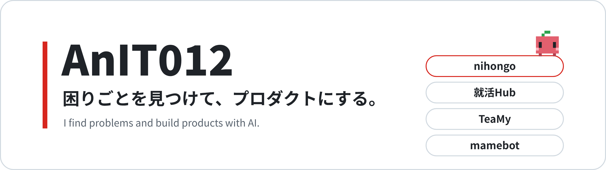

プロダクトデザイナー・PdM・DX人材志望の大学3年生です。自分や周りの困りごとを見つけて、要件と設計を自分で考えています。実装はAIに手伝ってもらい、プロダクトにしています。 
Aspiring Product Designer, PdM, or DX specialist. I find problems around me, design the requirements myself, and build products with AI.

[ポートフォリオ Portfolio](https://portfolio-site-navy-theta-52.vercel.app) ・ [記事 Articles (Zenn)](https://zenn.dev/anit)

## 作ったもの　What I've built

| プロダクト | 何をするか | 使われ方 |
|---|---|---|
| [**nihongo**](https://github.com/AnIT012/nihongo) | AIが書く日本語を人が書く文に近づける、エージェントスキルです。 An agent skill that makes AI-written Japanese read like a person wrote it. | GitHubの295スター・ユニーク2,252人がClone 295+ stars, 2,252 unique cloners |
| [**就活Hub**](https://portfolio-site-navy-theta-52.vercel.app/projects/shukatsu) [コード Code](https://github.com/AnIT012/shukatsu-hub) ・ [公開中 Live](https://shukatsu-dashboard-sable.vercel.app) | 「次の一手」が主役の就活管理アプリです。 A job-hunting app built around "your next move." | 10名以上が利用 Used by 10+ people |
| [**TeaMy**](https://portfolio-site-navy-theta-52.vercel.app/projects/teamy) [設計の記録 Design notes](https://github.com/AnIT012/TeaMy-design) | 8人のAIチームが話し合い、そのまま使える1枚にして渡します。 A team of eight AIs discusses the task and hands back a ready-to-use page. | コスト約1/3（1タスク20円前後） About 1/3 the cost (~20 yen per task) |
| [**mamebot**](https://portfolio-site-navy-theta-52.vercel.app/projects/mamebot) [コード Code](https://github.com/AnIT012/mamebot) | LINEのボタンだけで、家族に連絡が届くLINEボットです。 A LINE bot that messages the family with one button. | 家族4人が毎日利用 Used daily by a family of four |

### ほかに作ったもの　Other works

| プロダクト | 何をするか |
|---|---|
| [Ponte](https://github.com/AnIT012/Ponte) [試せます Try it](https://anit012.github.io/Ponte/play.html) | AIと開発するときに、決めていないことをAIに推測させないための言語です。 A language that stops AI from guessing what you haven't decided when building with AI. |
| [Teyvat Codex](https://teyvat-codex.pages.dev) | 原神の物語と仕様を調べられる、非公式の資料サイトです。 An unofficial reference site for Genshin Impact's story and game mechanics. |
| Irori | 家族の予定ややることを1つの画面にまとめた、家庭用のアプリです。 A home app that puts the family's schedule and to-dos on one screen. |
| [MyAgent](https://github.com/AnIT012/MyAgent) | 話しかけるだけで、パソコンの操作や予定の確認ができる音声アシスタントです。 A voice assistant that controls your PC and checks your schedule when you talk to it. |
| [PlanPal](https://github.com/AnIT012/PlanPal) | 使う人のことを学んで、ふだんの言葉から予定を提案するカレンダーです。 A calendar that learns about you and suggests plans from everyday words. |

## よく使うもの　Tools I use

